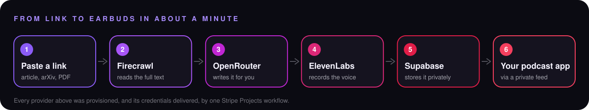
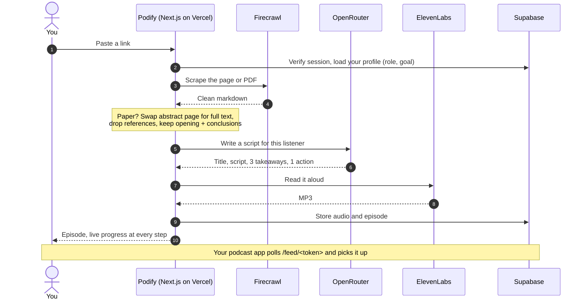
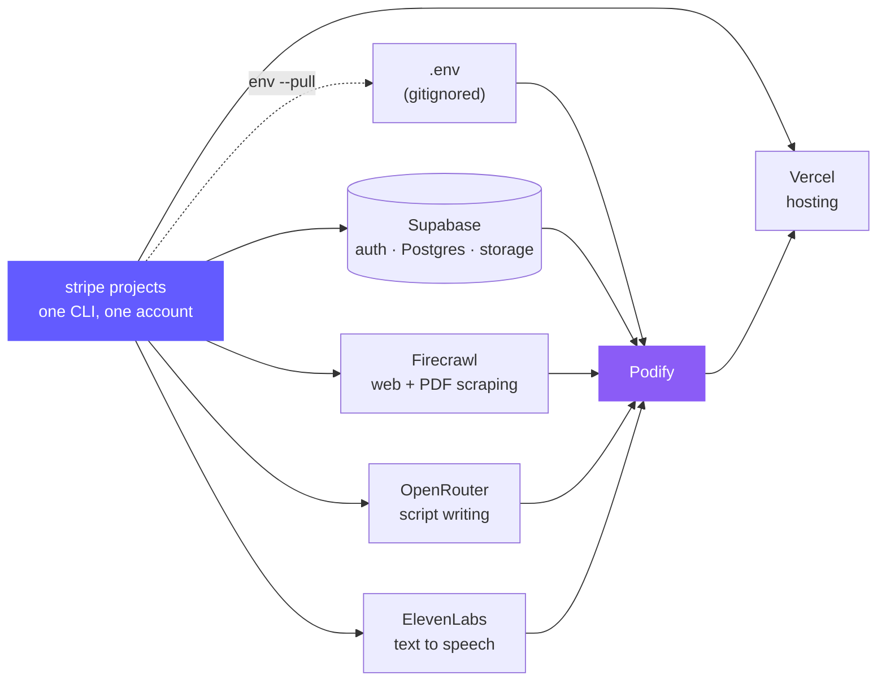

<p align="center">
  
</p>

<p align="center">
  <a href="https://podify-mocha.vercel.app"></a>
  <a href="https://projects.dev/s#v1:ElevenLabs~tts,Firecrawl~api,OpenRouter~api,Supabase~project,Vercel~project"></a>
  
  
</p>

<p align="center">
  <b>Paste a link. Get a two-minute episode that knows who is listening,<br>ends with something to do, and shows up in the podcast app you already use.</b>
</p>

---

## The problem

Your reading list is a graveyard. Forty open tabs, a folder of "must read" papers, and no hour in the day to sit and read any of it. You do have time when your eyes are busy and your ears are not: the commute, the dishes, the walk.

Tools that turn documents into audio already exist. Most of them give everyone the same summary, in an app you have to remember to open, and when it ends you have learned something and changed nothing.

## What Podify does differently

| | |
|---|---|
| 🎯 **Written for you** | Tell Podify who you are and what you are working towards, once. Every script is then cut around that: it keeps what matters to you, skips what does not, and speaks to you directly. |
| ✅ **Ends with a next step** | Each episode comes with three takeaways and one concrete thing to try this week. Listening is supposed to lead somewhere. |
| 📡 **Lives in your podcast app** | Every account gets a private RSS feed. Add it once to Apple Podcasts, Overcast, Pocket Casts or any app that takes a feed URL, and new episodes simply appear there. |
| 🔬 **Reads research papers properly** | Paste an arXiv, OpenReview or PDF link. Podify fetches the full text, keeps the opening and the conclusions, and explains the question, the method, the headline result with real numbers, and one honest limitation. |
| 🔗 **Shareable** | Every episode has a public page with the audio, takeaways and transcript. No login needed to listen. |
| ⚡ **Fast and free to run** | Roughly a minute from link to audio, on free tiers end to end. |

## How it works

<p align="center">
  
</p>



Progress is streamed to the browser as each step finishes, so the wait is visible instead of a spinner.

## A real example

Input: `https://arxiv.org/abs/1706.03762` ("Attention Is All You Need"), with the listener set to *a solo founder building a podcast app for a hackathon*.

> Can you build a world-class translation model without the usual step-by-step loop? The paper asks this because older systems handle sentences one word at a time, which makes training slow and hard to parallelize. The authors built the Transformer, an architecture that uses only attention. Attention is a way for the model to weigh which input words matter most when producing each output word...

**Takeaways it produced**

1. The Transformer replaces recurrence with attention so all positions can be processed at once.
2. Authors report 28.4 BLEU on English-to-German, beating the previous best by over 2 points.
3. Output is still generated one symbol at a time, which the authors call an open problem.

**Try this week:** Build a quick Transformer-powered summary or search feature for your app demo this week.

Notice what it did: it explained "attention" and "BLEU" in passing, quoted the paper's own number, named a limitation the authors admit to, and tied the ending to the listener's goal.

## Built with Stripe Projects

This is a Stripe hackathon entry, and Stripe Projects is the reason six services were wired together in minutes instead of an afternoon of sign-up forms and copy-pasted keys.



| What Stripe Projects did | Command |
|---|---|
| Found the exact provider and plan names | `stripe projects catalog` |
| Created the project | `stripe projects init podify` |
| Provisioned five providers on free plans | `stripe projects add <provider>/<service>` |
| Delivered every credential into one file | `stripe projects env --pull` |
| Showed plans and spend in one place | `stripe projects status` · `stripe projects spend` |
| Published the stack | `stripe projects share` |

The whole stack, as shared: [projects.dev/s#v1:ElevenLabs~tts,Firecrawl~api,OpenRouter~api,Supabase~project,Vercel~project](https://projects.dev/s#v1:ElevenLabs~tts,Firecrawl~api,OpenRouter~api,Supabase~project,Vercel~project)

Stripe Projects names some variables after the resource (for example `FIRECRAWL_API_API_KEY`, `SUPABASE_PROJECT_URL`). Rather than rename anything, `src/lib/env.ts` accepts a list of aliases per setting, so the app runs on whatever the CLI writes.

## The stack

| Layer | Service | Plan | Job |
|---|---|---|---|
| App | Next.js 16, React, Tailwind | | UI, API routes, RSS feed |
| Hosting | Vercel | Hobby | Deploys and serves the app |
| Auth, database, files | Supabase | Free | Users, episodes, profiles, MP3 storage, row level security |
| Reading | Firecrawl | Free | Turns web pages and PDFs into clean markdown |
| Writing | OpenRouter | Free | Free models with automatic fallback |
| Voice | ElevenLabs | Free | `eleven_flash_v2_5`, voice "George" |
| Provisioning | Stripe Projects | | Everything above |

## Run it yourself

You need Node 20+, the [Stripe CLI](https://docs.stripe.com/stripe-cli) and its `projects` plugin.

```bash
git clone https://github.com/neuralnomad26/podify && cd podify
npm install

stripe login
stripe plugin install projects
stripe projects init podify

# free plans first, then the services that depend on them
stripe projects add elevenlabs/tts
stripe projects add openrouter/api
stripe projects add firecrawl/free  && stripe projects add firecrawl/api
stripe projects add supabase/free   && stripe projects add supabase/project
stripe projects add vercel/hobby    && stripe projects add vercel/project

stripe projects env --pull          # writes .env
```

Then four manual steps:

1. **Supabase secret key.** Stripe Projects supplies the publishable key only. Copy the secret key from Supabase → Project Settings → API Keys into `.env.local` as `SUPABASE_SECRET_KEY=...`.
2. **Schema.** Run `supabase/setup.sql` in the Supabase SQL editor. It is safe to run more than once.
3. **Sign-ups.** In Supabase → Authentication → Sign In / Providers → Email, turn off "Confirm email" so demo sign-ups work instantly.
4. **A free model.** OpenRouter's free plan cannot call paid models. In `.env.local`, set a comma-separated list of free models; the first is preferred and the rest are fallbacks:
   ```
   OPENROUTER_MODEL=nvidia/nemotron-3.5-super-vl:free,baidu/ernie-5.5-flash-preview:free,google/gemma-4-31b-it:free
   ```

```bash
npm run dev
# open /api/health: every value should be true and "database" should be "ok"
```

To deploy, set the same variables on Vercel and run `vercel deploy --prod`. `SETUP.md` has the longer walkthrough, including a prompt that lets a coding agent do all of this for you.

### Configuration

| Variable | Required | Notes |
|---|---|---|
| `SUPABASE_URL` or `SUPABASE_PROJECT_URL` | yes | Project URL |
| `SUPABASE_PUBLISHABLE_KEY` or `SUPABASE_ANON_KEY` | yes | Safe to expose to the browser |
| `SUPABASE_SECRET_KEY` or `SUPABASE_SERVICE_ROLE_KEY` | yes | Server only. Never give it a `NEXT_PUBLIC_` name |
| `FIRECRAWL_API_KEY` or `FIRECRAWL_API_API_KEY` | yes | |
| `OPENROUTER_API_KEY` | yes | |
| `ELEVENLABS_API_KEY` | yes | |
| `OPENROUTER_MODEL` | no | One model, or up to three separated by commas. Default `openai/gpt-4o-mini` (paid) |
| `ELEVENLABS_VOICE_ID` | no | Default `JBFqnCBsd6RMkjVDRZzb` (George) |

## Project map

```
src/
├─ app/
│  ├─ page.tsx               server entry, hands public config to the client
│  ├─ api/podify/route.ts    the pipeline endpoint, streams progress as NDJSON
│  ├─ api/health/route.ts    which keys are set, is the database reachable
│  ├─ feed/[token]/route.ts  private podcast RSS feed
│  └─ e/[id]/page.tsx        public share page
├─ components/PodifyApp.tsx  sign-in, studio, profile, feed link, episode cards
└─ lib/
   ├─ env.ts                 the only place env vars are read (with aliases)
   ├─ pipeline.ts            scrape → write → synthesize, plus paper handling
   └─ supabase-admin.ts      server-only Supabase client
supabase/setup.sql           tables, row level security, storage bucket
.claude/                     agent, guard hook and settings for Claude Code
AGENTS.md                    rules every coding agent must follow here
```

## Privacy and safety

- **Row level security** on every table. A signed-in user can read only their own episodes and profile.
- **The feed token is generated by the database.** Users can edit their role and goal, but column-level grants stop them from writing `feed_token`, so nobody can point their feed at someone else's.
- **The feed link is a secret.** Anyone holding it can listen, which is how podcast apps need it to work. It is marked `noindex` and blocked from podcast directories.
- **Secrets stay on the server.** Only the Supabase URL and publishable key reach the browser. `.env`, `.env.local` and the Stripe Projects vault are gitignored.
- **Honest scripts.** The paper prompt tells the model to attribute findings ("the authors report"), to use only numbers that appear in the paper, and to name a limitation.

## Built with an agent, on a leash

Most of this repo was assembled by a coding agent, so the repo also carries the rules that agent works under:

- `AGENTS.md` sets the ground rules: never print or commit secrets, free tier only, ask before anything destructive or public.
- `.claude/hooks/guard-bash.mjs` is a pre-command check that blocks paid plans and billing changes, refuses to print `.env` or the vault, scans commits for key patterns, and asks before removing services, rotating credentials or force pushing.
- `.claude/agents/podify-builder.md` is a project-specific builder agent that knows the layout, the roadmap and the verification steps.

## Known limits

- Episodes are capped at about 350 words (around two minutes) to stay inside the ElevenLabs free quota.
- Free OpenRouter models are sometimes rate-limited upstream. The fallback list helps; an occasional retry is still needed.
- Very long papers are trimmed to their opening and closing sections, so detail from the middle can be lost.
- Paywalled pages and scanned-image PDFs may not yield enough text.
- One voice, one host, English only.

## Roadmap

- [x] Article to episode, with live progress
- [x] Episodes written for the listener, with takeaways and an action
- [x] Private podcast feed
- [x] Research papers (arXiv, OpenReview, PDFs)
- [ ] Podify Pro with Stripe Checkout: free monthly cap, subscription, Customer Portal
- [ ] Daily digest: several saved links merged into one episode
- [ ] Two-host conversations and voice choice

---

<p align="center">
  Built for the Stripe hackathon with Stripe Projects, Supabase, Firecrawl, OpenRouter, ElevenLabs and Vercel.
</p>
